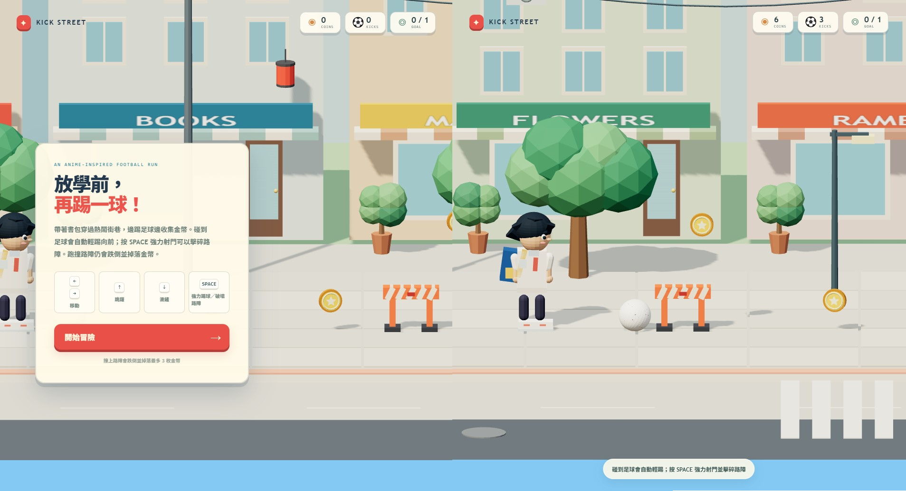
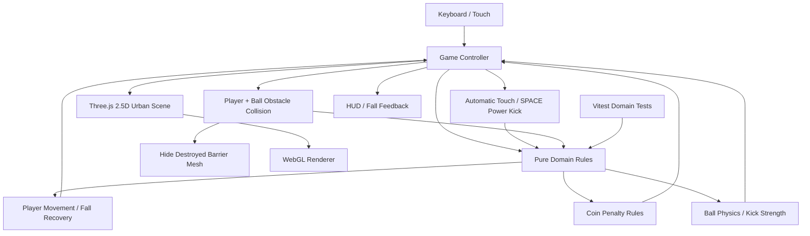

# Kick Street — 足球小冒險

一款使用 Three.js + TypeScript 製作的原創純網頁足球冒險遊戲。視覺方向參考《Kick》公開預告中的動漫風 2.5D 橫向冒險、城市街道、收集金幣與躲避障礙等一般風格特徵；遊戲角色、街景、標誌、幾何素材與程式皆為原創，沒有匯入原作截圖或素材。



## 開始遊玩

需求：Node.js 22.12+、npm，以及支援 WebGL 的現代瀏覽器。

```bash
npm install
npm run dev
```

Vite 會輸出本機網址（通常是 `http://localhost:5173`）。開啟後按「開始冒險」。

```bash
npm test       # 執行 Domain 單元測試
npm run lint   # ESLint
npm run build  # TypeScript type-check + production build
npm run preview
npm run coverage
```

## 操作方式

| 按鍵 | 動作 | 行為 |
|---|---|---|
| `←` | 左移 | 向左跑動並改變角色朝向 |
| `→` | 右移 | 向右跑動並改變角色朝向 |
| `↑` | 跳躍 | 只在地面時起跳；不能連續二段跳 |
| `↓` | 滑鏟 | 地面觸發短時間加速，可穿過低路障 |
| 自動觸球 | 輕踢 | 人物在地面碰到慢速足球時，會朝角色面向自動輕踢，讓球保持向前滾動 |
| `Space` | 強力踢球 | 靠近足球時施加高速度強力射門；球擊中路障時可擊碎，強力狀態會延續到後續碰撞 |

人物撞上尚未破壞的路障會進入約 0.9 秒的跌倒恢復狀態，期間不能移動、跳躍或踢球；每次撞擊扣除最多 3 枚金幣，金幣不足時餘額歸零。球碰到路障時，輕踢只會讓球停在路障前；SPACE 強力踢球會擊碎命中的路障；強力狀態不會在第一個路障後被清除，因此同一球若繼續撞上其他路障，也能將其擊碎。跳躍越過、滑鏟通過或先用強力球擊碎路障，都能避開人物碰撞懲罰。窄螢幕也提供觸控按鈕。

## MVP 範圍

- [x] Three.js 場景、側向正交相機、城市建築、商店招牌、電線、路燈、樹木、斑馬線與磁磚人行道
- [x] 原創動漫比例學生角色、書包、校服、跑步／踢球／跌倒姿勢、足球與金色代幣
- [x] 左右移動、跳躍、重力、落地判定、滑鏟與跌倒恢復
- [x] 足球地面摩擦、空中重力、彈跳、自動輕踢與 SPACE 強力踢球
- [x] 輕踢撞障礙時停球；強力踢球可擊碎命中的路障，並在後續碰撞保留強力狀態
- [x] 路障視覺分組，可在遊戲中破壞並於重新開始時復原
- [x] 金幣收集、路障碰撞、最多 3 枚金幣懲罰、球門與完成畫面
- [x] HUD、重新開始、鍵盤與觸控操作
- [x] Domain 單元測試、架構圖、ADR、MEM、CHANGELOG 與 todo
- [ ] 瀏覽器 E2E / 自動化截圖回歸
- [ ] 音效、音樂、Rigged character 與多關卡
- [ ] 道具、存檔、設定選單（目前不需要）

## 架構



### 依賴影響圖（Impact Graph）

```text
Keyboard / Touch
       |
       v
 Game Controller -----------------------> DOM HUD / Coin Balance
       |                                      ^
       v                                      |
 Player / Ball Collision Adapter ------> Domain Rules <------ Unit Tests
       |                                      |
       |                                      v
       +--------------------------------> Player / Ball State
                                              |
                                              v
                                  Three.js SceneFactory
                                              |
                                              v
                                       WebGL Renderer
```

- `src/domain/`：純 TypeScript 遊戲規則，不依賴 DOM 或 Three.js，可快速單元測試。
- `src/game/`：鍵盤／觸控輸入、遊戲迴圈、自動輕踢／強力踢球、球與角色的障礙碰撞整合、金幣錢包及規則狀態到視覺物件的同步。
- `src/main.ts`：DOM 組裝與錯誤提示。
- `tests/`：使用 AAA（Arrange / Act / Assert）測試 Domain 行為。

## 技術取捨

**[Trade-off Analysis]**

| 決策 | 優點 | 代價 | 原因 |
|---|---|---|---|
| Three.js + TypeScript | 3D 即時渲染、型別檢查、瀏覽器原生執行 | 需自行管理場景、動畫與遊戲迴圈 | 符合指定技術並保留對渲染細節的控制 |
| 自製輕量物理 | 易測試、依賴少、可直接調整遊戲手感 | 球體與場景沒有完整剛體物理 | MVP 只需可預期的跳躍、滑行、碰撞和球體運動 |
| 無後端 | 啟動與部署簡單、不需憑證或資料庫 | 沒有雲端存檔或排行榜 | 使用者要求純網頁遊戲，當前需求不需伺服器 |
| 程式生成場景 | 自包含、可調整、無需下載 3D 模型 | 不如原畫或骨架動畫細膩，網格數量也較多 | 保留原創性，快速形成動漫風 2.5D 街景 |
| Vitest + Domain 測試 | 快速且 deterministic | 無法完整驗證 WebGL 畫面與實際輸入 | 先涵蓋規則，再以 E2E 補足瀏覽器驗收 |

## 工程規範對應

- TDD：跌倒、金幣懲罰、路障穿越、自動輕踢、強力踢球與障礙破壞規則都有 Domain 單元測試；新增規則應先增測試，再修改 Domain。
- 覆蓋率：`npm run coverage` 對 `src/domain/**/*.ts` 設定 80% 門檻。
- 安全：不需要 API keys、帳密、Token、後端 endpoints 或 `.env`；不要為此 MVP 添加秘密值。
- 可觀測性：瀏覽器初始化錯誤會輸出到 console，並提供使用者可見提示；本專案沒有伺服器請求，因此不設 trace-id / request logging。
- Commit：使用 Conventional Commits 與 Phase Flow；`main` 保持可測試，階段分支保留並加上 Phase Tag。
- 每次改變 Domain 規則時，同步檢查 `docs/architecture/overview.md`、對應測試及 `CHANGELOG.md`。

## 驗證狀態與已知限制

本次環境以 TypeScript 編譯器檢查 Domain，並使用臨時的 Vitest 相容測試執行器跑完整 38 個 Domain 測試案例，38 個通過；6 個 TypeScript 原始碼／測試檔也通過語法轉譯檢查。這不是官方 Vitest runner；應用程式也只使用臨時 Three.js API 宣告做過 strict type-check，尚未以實際 `three`／`@types/three` 套件驗證。由於此環境沒有已安裝的 npm 相依套件，正式 `npm test`、`npm run lint`、覆蓋率、`npm run build` 以及真實瀏覽器 WebGL 驗收仍未確認，請在可連線的開發環境執行上述命令。

物理仍是為遊戲手感設計的簡化模型，並非完整剛體求解；目前是單段關卡，尚未加入音訊、持久化與瀏覽器端 E2E 測試。
