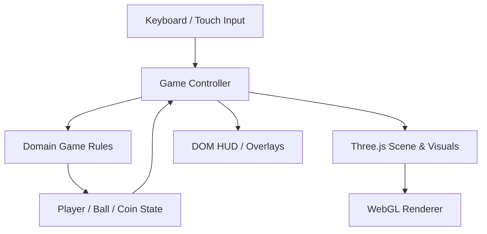

# Kick Street — 足球小冒險

一款受 [《Kick》發售預告](https://youtu.be/QQn899tA2vo) 的輕鬆足球冒險氛圍啟發、使用 Three.js + TypeScript 製作的原創純網頁 3D 遊戲。角色、場景與素材皆由幾何圖形即時組成，不使用原作素材，也不需要後端服務。

## 開始遊玩

需求：Node.js 22.12+、npm，以及支援 WebGL 的現代瀏覽器。

```bash
npm install
npm run dev
```

Vite 會輸出本機網址（通常是 `http://localhost:5173`）。開啟後按「開始冒險」。

```bash
npm test       # 執行 Domain 單元測試
npm run lint   # ESLint
npm run build  # TypeScript type-check + production build
npm run preview
npm run coverage
```

## 操作方式

| 按鍵 | 動作 | 行為 |
|---|---|---|
| `←` | 左移 | 向左跑動並改變角色朝向 |
| `→` | 右移 | 向右跑動並改變角色朝向 |
| `↑` | 跳躍 | 只在地面時起跳；不能連續二段跳 |
| `↓` | 滑鏟 | 地面觸發短時間加速，可穿過低路障 |
| `Space` | 踢球 | 靠近足球、面向足球時踢出帶有拋物線的球 |

窄螢幕也提供簡單觸控按鈕。靠近路障時可以跳過或滑鏟通過；沿途金幣會計分，最後把球踢進學校門前的球門即可完成關卡。

## MVP 範圍

- [x] Three.js 場景、相機、燈光、陰影、原創低多邊形角色與球體
- [x] 左右移動、面向、跳躍、重力、落地判定、滑鏟
- [x] 足球地面摩擦、空中重力、彈跳與踢球冷卻
- [x] 金幣收集、路障、球門與完成畫面
- [x] HUD、重新開始、鍵盤與觸控操作
- [x] Domain 規則單元測試、架構圖、ADR、CHANGELOG 與 todo
- [ ] 瀏覽器 E2E / 自動化截圖回歸
- [ ] 音效、音樂、動畫精修與多關卡
- [ ] 道具、存檔、設定選單（MVP 不需要）

## 架構



### 依賴影響圖（Impact Graph）

```text
Keyboard / Touch
       |
       v
  Game Controller  -----------------> DOM HUD
       |
       v
  Domain Rules  <-------------------- Unit Tests
       |
       v
  Player / Ball / Coin State
       |
       v
 Three.js SceneFactory -----------> WebGL Renderer
```

- `src/domain/`：純 TypeScript 遊戲規則，不依賴 DOM 或 Three.js，可快速單元測試。
- `src/game/`：鍵盤／觸控輸入、遊戲迴圈、碰撞與規則狀態到視覺物件的同步。
- `src/main.ts`：DOM 組裝與錯誤提示。
- `tests/`：使用 AAA（Arrange / Act / Assert）測試 Domain 行為。

## 技術取捨

**[Trade-off Analysis]**

| 決策 | 優點 | 代價 | 原因 |
|---|---|---|---|
| Three.js + TypeScript | 3D 即時渲染、型別檢查、瀏覽器原生執行 | 需自行管理場景、動畫與遊戲迴圈 | 符合指定技術並保留對渲染細節的控制 |
| 自製輕量物理 | 易測試、依賴少、可直接調整遊戲手感 | 不會模擬真實剛體碰撞 | MVP 只需可預期的跳躍、滑行、球體運動 |
| 無後端 | 啟動與部署簡單、不需憑證或資料庫 | 沒有雲端存檔或排行榜 | 使用者要求純網頁遊戲，當前需求不需伺服器 |
| 幾何圖形生成素材 | 專案自包含、不需下載模型 | 角色細節與動作自然度有限 | 可快速建立可玩原型，也避免複製影片的原作素材 |
| Vitest + Domain 測試 | 快速且 deterministic | 無法完整驗證 WebGL 畫面與實際輸入 | 先涵蓋規則，再在後續階段增加 E2E |

## 工程規範對應

- TDD：`tests/gameRules.test.ts` 定義核心行為；新增規則應先增測試，再修改 Domain。
- 覆蓋率：`npm run coverage` 對 `src/domain/**/*.ts` 設定 80% 門檻。
- 安全：不需要 API keys、帳密、Token、後端 endpoints 或 `.env`；不要為此 MVP 添加秘密值。
- 可觀測性：瀏覽器初始化錯誤會輸出到 console，並提供使用者可見提示；本專案沒有伺服器請求，因此不設 trace-id / request logging。
- Commit：使用 Conventional Commits；`main` 應保持可測試，新增功能在短期分支上完成並透過 PR 合併。
- 每次改變 Domain 規則時，同步檢查 `docs/architecture/overview.md`、對應測試及 `CHANGELOG.md`。

## 已知限制

目前物理是為遊戲手感設計的簡化模型，非精確的剛體模擬；球體與路障沒有完整的 3D 碰撞求解。MVP 以一段橫向關卡為主，尚未加入音訊、持久化與瀏覽器端 E2E 測試。
