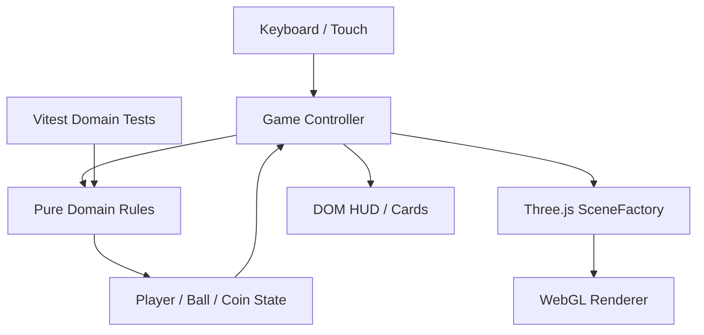

# Architecture Overview

Date: 2026-10-19
Status: MVP baseline

## Context
This is a browser-only game. Server-side concepts such as Controllers, UseCases, Repositories, tracing, idempotency keys, and secret stores would add no value because the game makes no network requests and stores no user data. Gameplay inspiration: [Kick — Official Release Date Trailer](https://youtu.be/QQn899tA2vo); all meshes and implementation are original.

## Component Graph



## State Flow

1. `Game` reads held and just-pressed input each animation frame.
2. `stepPlayer` and `stepBall` integrate deterministic state using delta time clamped to 50 ms.
3. Collision integration handles low obstacles; collection and goal checks update objective state.
4. The view layer maps domain state to the character group, ball group, coin groups, camera, and HUD.

## Dependencies

```text
src/main.ts
   |-- src/game/Game.ts
   |      |-- src/domain/gameRules.ts
   |      |-- src/domain/types.ts
   |      `-- src/game/SceneFactory.ts
   `-- src/styles.css

tests/gameRules.test.ts --> src/domain/gameRules.ts
```

## Architectural boundaries
- `domain` must remain independent of Three.js and browser APIs.
- `SceneFactory` owns procedural 3D asset creation, not game rules.
- `Game` is the adapter that translates inputs and domain state into render objects.
- `main` wires HTML elements and handles startup failure.

## Non-goals for the MVP
No backend, user accounts, database, online leaderboard, API, analytics, environment secrets, or external model download. These can be reconsidered only if product requirements change.
