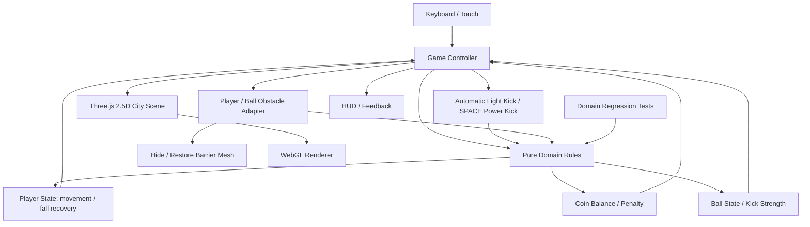

# Architecture Overview

Date: 2026-10-19
Status: Phase 2 — automatic light kick and power-shot obstacle destruction

## Context
This is a browser-only game. Server-side concepts such as Controllers, UseCases, Repositories, tracing, idempotency keys, and secret stores would add no value because the game makes no network requests and stores no user data. Visual direction is informed by the reference game's anime 2.5D side-scrolling presentation, urban streets, collectable coins, and obstacle avoidance; all game assets and code in this repository remain original.

## Component Graph



## State Flow

1. `Game` reads held and just-pressed input each animation frame.
2. `stepPlayer` and `stepBall` integrate deterministic state using delta time clamped to 50 ms.
3. When a grounded player touches a slow-moving ball and the kick cooldown has expired, the controller applies a forward light kick. SPACE applies a distinct power kick when the ball is within reach.
4. The ball-obstacle adapter detects a swept collision so a fast ball cannot tunnel through a barrier between frames. Light kicks stop at the barrier; a power kick destroys exactly the first barrier it hits and then consumes its one-impact power state.
5. The player collision adapter detects an obstacle crossing unless the player is sliding beneath or jumping above it. A collision starts a timed fall state and applies one coin penalty.
6. While `fallRemaining > 0`, player input is ignored and the player remains grounded; the view animates a stumble/tilt. Recovery allows control again.
7. `coinBalance` is the spendable HUD balance. Collecting a coin increases it by one; hitting an obstacle subtracts up to three coins, clamped at zero. Collectable-world state remains separate so collected coins do not reappear until restart.
8. The view layer maps player, coin, ball, obstacle and goal state to original Three.js meshes, camera, lighting, and HUD.

## Dependencies

```text
src/main.ts
   |-- src/game/Game.ts
   |      |-- src/domain/gameRules.ts
   |      |-- src/domain/types.ts
   |      `-- src/game/SceneFactory.ts
   `-- src/styles.css

tests/gameRules.test.ts --> src/domain/gameRules.ts
```

## Architectural boundaries
- `domain` must remain independent of Three.js and browser APIs.
- `SceneFactory` owns procedural 2.5D urban art assets, not game rules; it returns each barrier mesh as a grouped visual so gameplay can remove it without coupling rules to Three.js.
- Kick velocity, touch detection, swept ball-obstacle collision, and obstacle-impact outcomes remain pure Domain rules. The controller applies the result to the scene meshes.
- `Game` is the adapter that translates inputs, obstacle crossings and domain state into render objects.
- `main` wires HTML elements and handles startup failure.

## Art direction
- Side-on orthographic camera with layered Japanese-inspired street buildings, storefront signs, utility poles, trees, tiled sidewalk, road paint and a crosswalk.
- Anime-proportioned student with dark swept hair, school clothes, visible backpack and oversized sneakers.
- Saturated but controlled colors, clear silhouettes, warm directional light, high-contrast obstacle markings, and readable gold tokens.
- Do not use original game screenshots, logos, characters, textures or extracted assets.

## Non-goals
No backend, user accounts, database, online leaderboard, API, analytics, environment secrets, or external model download. These can be reconsidered only if product requirements change.
